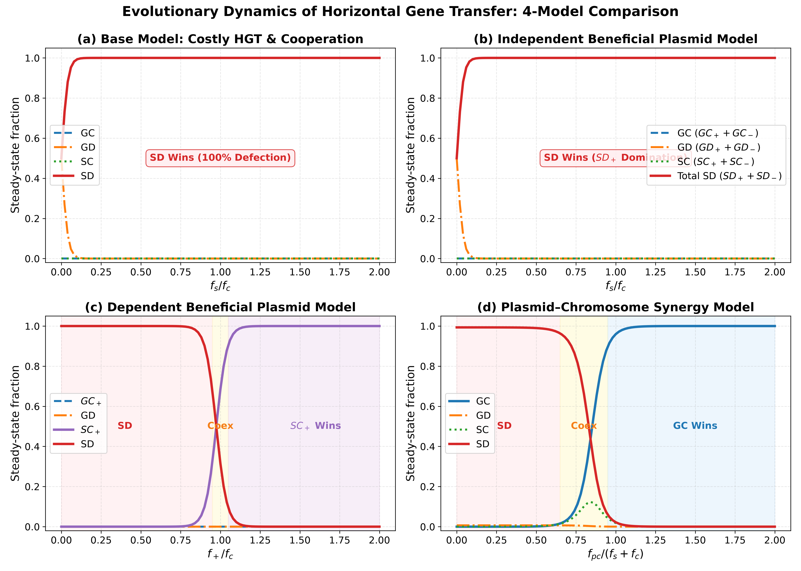
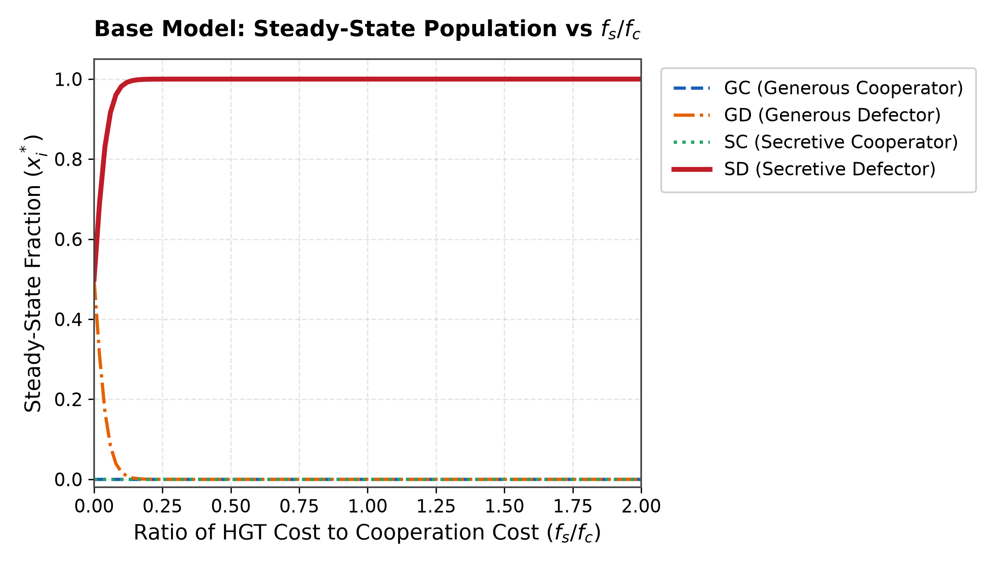
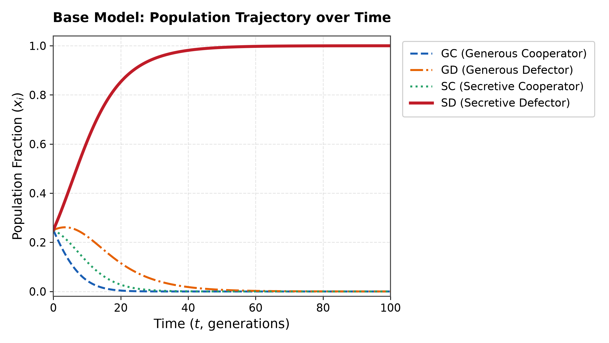
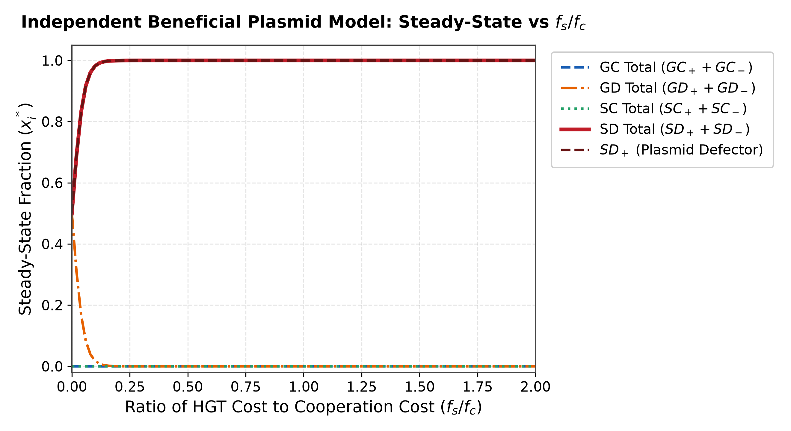
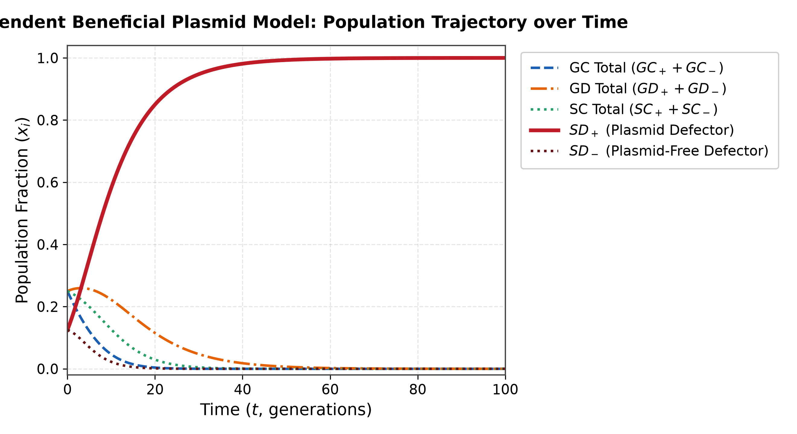
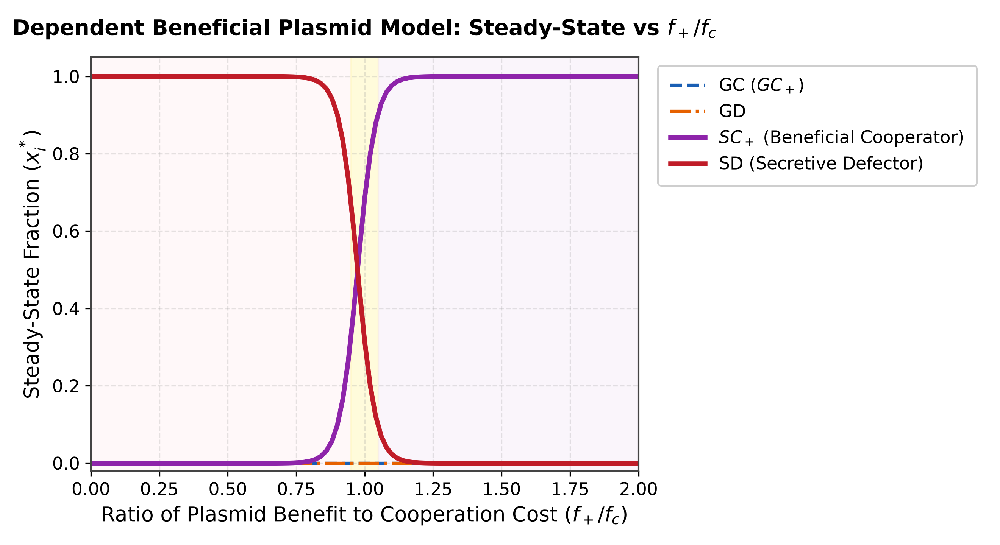
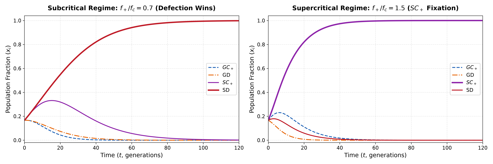
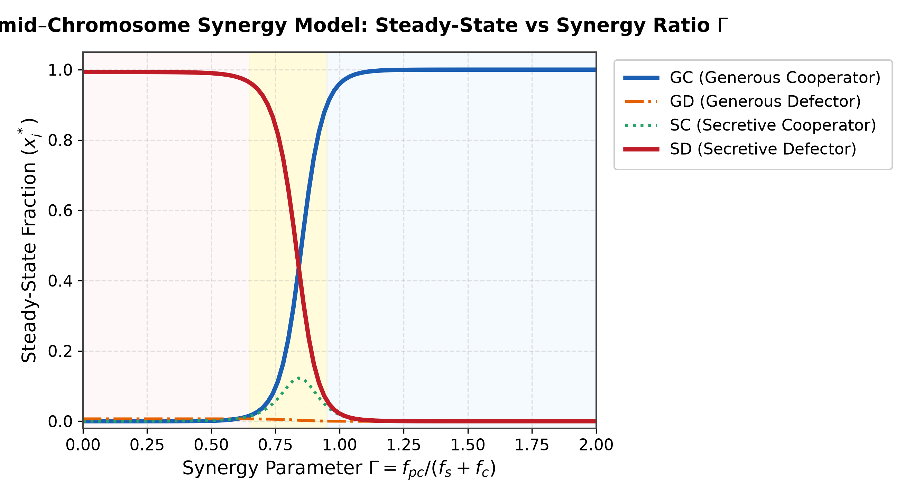
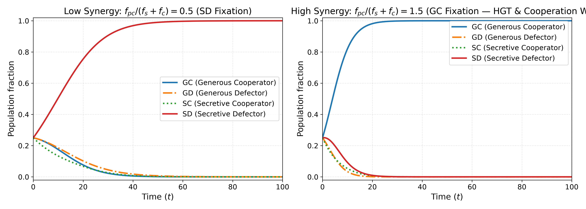

# To Gossip or Not To Gossip: The Evolution of Cooperation Under Horizontal Gene Transfer

[](https://www.python.org/)
[](https://opensource.org/licenses/MIT)
[](BEE26_To_Gossip_or_Not_To_Gossip.ipynb)
[](https://www.imsc.res.in/)

A mathematical and computational investigation of the evolutionary dynamics of **Horizontal Gene Transfer (HGT)** and **bacterial cooperation** in public goods games, developed during the **Behavior, Evolution, Emergence 2026 (BEE 2026)** workshop at **The Institute of Mathematical Sciences (IMSc), Chennai**.

---

## 👥 Authors & Team Credits

This project was developed collaboratively as a team research project for **BEE 2026 (IMSc)**:
- **Ananya** (BEE 2026, IMSc)
- **Shrayansh** (BEE 2026, IMSc)
- **Yogesh** (BEE 2026, IMSc)

### Acknowledgements
We extend our heartfelt gratitude to the BEE 2026 instructors and mentors for their guidance and discussions:
- **Shakti**, **Saptarishi**, **Kalyani**, **Varuni**, and **Saini**.

---

## 📖 Table of Contents
1. [The Biological Riddle](#-the-biological-riddle)
2. [Master Overview: 4-Model Comparison](#-master-overview-4-model-comparison)
3. [Model 1: The Base Model](#-model-1-the-base-model)
4. [Model 2: Independent Beneficial Plasmid Model](#-model-2-independent-beneficial-plasmid-model)
5. [Model 3: Dependent Beneficial Plasmid Model](#-model-3-dependent-beneficial-plasmid-model)
6. [Model 4: Plasmid–Chromosome Synergy Model](#-model-4-plasmidchromosome-synergy-model)
7. [Comparative Synthesis & Inferences](#-comparative-synthesis--inferences)
8. [What Can Be Done Further (Future Directions)](#-what-can-be-done-further-future-directions)
9. [Project Structure & Execution](#-project-structure--execution)
10. [References](#-references)

---

## 🧬 The Biological Riddle

Horizontal Gene Transfer (HGT)—the non-genealogical transmission of genetic material between independent unicellular organisms—presents an evolutionary enigma:

- **Ubiquitous in Nature:** Over **80% of bacterial genes** show evidence of lateral acquisition. Almost all bacterial taxa engage in HGT.
- **Biologically Costly:** Conjugation is a donor-driven process. The donor cell pays heavy energetic and biosynthetic costs ($f_s$) to assemble the Type IV secretion system (T4SS), synthesize the conjugative pilus, and mobilize DNA.
- **Altruistic Transfer:** Donors share advantageous genetic adaptations (e.g., metabolic enzymes, antibiotic resistance, siderophores) with surrounding cells that may directly compete for shared environmental niches.

In a **bacterial public goods game** (such as iron-scavenging siderophore secretion), cooperators pay a metabolic cost ($f_c$) to release public goods that can be exploited by non-producing defectors. 

> **Central Question:** How can costly gene donation (HGT) and costly cooperation evolve and persist without collapsing to non-conjugating cheaters?

---

## 📊 Master Overview: 4-Model Comparison

The figure below summarizes the steady-state outcomes across the four evolutionary models:



| Model | Key Feature | Dominant Steady State | Outcome for Cooperation | Outcome for HGT |
| :--- | :--- | :--- | :--- | :--- |
| **1. Base Model** | Costly cooperation ($f_c$) + costly HGT ($f_s$) | **$SD$ (100%)** | ❌ Extinct | ❌ Extinct |
| **2. Independent Plasmid** | Universal plasmid fitness benefit ($f_+$) | **$SD_+$ (100%)** | ❌ Extinct | ❌ Extinct |
| **3. Dependent Plasmid** | Plasmid benefit conditional on cooperation ($f_+$) | **$SD$ or $SC_+$** ($f_+ > f_c$) | ✅ **Rescued** | ❌ Extinct |
| **4. Synergy Model** | Epistatic synergy between chromosome & plasmid ($f_{pc}$) | **$GC$ (100%)** ($\Gamma > 1.1$) | ✅ **Rescued** | ✅ **Rescued** |

---

## 🔬 Model 1: The Base Model

### Mathematical Formulation
The population is classified into four fundamental strategies:
- $GC$: **Generous Cooperator** (cooperates, performs HGT)
- $GD$: **Generous Defector** (defects, performs HGT)
- $SC$: **Secretive Cooperator** (cooperates, refrains from HGT)
- $SD$: **Secretive Defector** (defects, refrains from HGT)

Let $x = [GC, GD, SC, SD]^\top$ denote population fractions with $\sum_i x_i = 1$.

#### Fitness Functions
$$\begin{aligned}
f_{GC} &= 1 - f_c \\
f_{GD} &= 1 \\
f_{SC} &= 1 + f_s - f_c \\
f_{SD} &= 1 + f_s
\end{aligned}$$
where $f_c > 0$ is the cost of cooperation, and $f_s > 0$ is the cost of performing HGT (manifested as an avoidance advantage for secretive types).

The population-weighted mean fitness is:
$$\bar{f} = 1 - f_c(GC + SC) + f_s(SC + SD)$$

#### Conjugation Kinetics & Replicator ODEs
Conjugation events driven by generous cooperators ($GC$):
$$\begin{aligned}
GC + SD &\xrightarrow{\alpha} GC + SC \\
GC + GD &\xrightarrow{\alpha} 2GC
\end{aligned}$$

The replicator-conjugation dynamics:
$$\begin{aligned}
\dot{GC} &= (f_{GC} - \bar{f})GC + \alpha \cdot GC \cdot GD \\
\dot{GD} &= (f_{GD} - \bar{f})GD - \alpha \cdot GC \cdot GD \\
\dot{SC} &= (f_{SC} - \bar{f})SC + \alpha \cdot GC \cdot SD \\
\dot{SD} &= (f_{SD} - \bar{f})SD - \alpha \cdot GC \cdot SD
\end{aligned}$$

**Simplex Invariance Proof:**
$$\sum_i \dot{x}_i = \sum_i (f_i - \bar{f})x_i + \alpha GC \cdot GD - \alpha GC \cdot GD + \alpha GC \cdot SD - \alpha GC \cdot SD = (\bar{f} - \bar{f}) + 0 = 0$$

### Results & Inferences
<p align="center">
  
  
</p>

- **Defector Dominance:** Defectors outcompete cooperators within each HGT class ($f_{SD} - f_{SC} = f_c > 0$ and $f_{GD} - f_{GC} = f_c > 0$).
- **The Double Cost Barrier:** $GC$ pays both $f_c$ and $f_s$, making it the least fit phenotype in the system ($f_{GC} = 1 - f_c < 1 < 1 + f_s = f_{SD}$).
- **Collapse of Conjugation:** While conjugation converts defectors to cooperators, the rate is proportional to $GC$. As selection purges $GC$, conjugation grinds to a halt, driving $SD$ to 100% fixation across all $f_s / f_c$.

---

## 🧬 Model 2: Independent Beneficial Plasmid Model

### Mathematical Formulation
To examine whether an independently beneficial plasmid can sustain HGT, the population is expanded to 8 types based on plasmid carriage ($+$ or $-$):
$$x = [GC_+, GC_-, GD_+, GD_-, SC_+, SC_-, SD_+, SD_-]^\top$$

#### Fitness Functions
Every plasmid-bearing cell receives a fitness benefit $f_+$ independently of its social or HGT behavior:
$$\begin{aligned}
f_{GC_+} &= 1 - f_c + f_+ & f_{GC_-} &= 1 - f_c \\
f_{GD_+} &= 1 + f_+       & f_{GD_-} &= 1 \\
f_{SC_+} &= 1 + f_s - f_c + f_+ & f_{SC_-} &= 1 + f_s - f_c \\
f_{SD_+} &= 1 + f_s + f_+ & f_{SD_-} &= 1 + f_s
\end{aligned}$$

#### The Dual Conversion Event: $2GC_+$
Generous donors transfer plasmids and chromosomal genes. A key kinetic interaction occurs when a plasmid-free cooperator meets a plasmid-bearing defector:
$$GC_- + GD_+ \xrightarrow{\alpha} 2GC_+$$
Reciprocal exchange occurs: $GC_-$ transfers cooperation to $GD_+$, while $GD_+$ transfers the plasmid to $GC_-$, producing two $GC_+$ cells!

#### ODE System
$$\begin{aligned}
\dot{GC}_+ &= (f_{GC_+} - \bar{f})GC_+ + \alpha(GC_+ GC_- + GC_+ GD_+ + GC_+ GD_- + 2 GC_- GD_+) \\
\dot{GC}_- &= (f_{GC_-} - \bar{f})GC_- + \alpha(GC_- GD_- - GC_+ GC_- - GC_- GD_+) \\
\dot{GD}_+ &= (f_{GD_+} - \bar{f})GD_+ + \alpha(GD_+ GD_- - GC_+ GD_+ - GC_- GD_+) \\
\dot{GD}_- &= (f_{GD_-} - \bar{f})GD_- + \alpha(-GC_+ GD_- - GC_- GD_- - GD_+ GD_-) \\
\dot{SC}_+ &= (f_{SC_+} - \bar{f})SC_+ + \alpha(GC_+ SC_- + GC_+ SD_+ + GC_+ SD_- + GC_- SD_+ + GD_+ SC_-) \\
\dot{SC}_- &= (f_{SC_-} - \bar{f})SC_- + \alpha(GC_- SD_- - GC_+ SC_- - GD_+ SC_-) \\
\dot{SD}_+ &= (f_{SD_+} - \bar{f})SD_+ + \alpha(GD_+ SD_- - GC_+ SD_+ - GC_- SD_+) \\
\dot{SD}_- &= (f_{SD_-} - \bar{f})SD_- + \alpha(-GD_+ SD_- - GC_+ SD_- - GC_- SD_-)
\end{aligned}$$

### Results & Inferences
<p align="center">
  
  
</p>

- **Beneficial Plasmids Are Parasitized:** Because $f_+$ is universally accessible, defectors simply acquire the plasmid via conjugation without paying for cooperation or HGT machinery.
- **Preserved Fitness Gradient:** Relative fitness advantages remain strictly identical:
  $$f_{SD_+} - f_{SC_+} = f_c, \quad f_{SD_+} - f_{GD_+} = f_s$$
- $SD_+$ fixes completely. Merely providing a beneficial plasmid independently fails to protect cooperation or HGT.

---

## 🛡️ Model 3: Dependent Beneficial Plasmid Model

### Mathematical Formulation
Here, plasmid benefit is conditional: the plasmid enhances fitness ($f_+$) **only when expressed in a cooperative host** (e.g., metabolic complementation with public goods production). Non-cooperating defectors do not maintain or benefit from the plasmid, yielding 6 types:
$$x = [GC_+, GC_-, GD, SC_+, SC_-, SD]^\top$$

#### Fitness Functions
$$\begin{aligned}
f_{GC_+} &= 1 - f_c + f_+ \\
f_{GC_-} &= 1 - f_c \\
f_{GD}   &= 1 \\
f_{SC_+} &= 1 + f_s - f_c + f_+ \\
f_{SC_-} &= 1 + f_s - f_c \\
f_{SD}   &= 1 + f_s
\end{aligned}$$

#### The Critical Bifurcation
Comparing the fittest cooperator ($SC_+$) with the fittest defector ($SD$):
$$f_{SC_+} - f_{SD} = (1 + f_s - f_c + f_+) - (1 + f_s) = f_+ - f_c$$
- **Subcritical ($f_+ / f_c < 1$):** Defectors dominate ($SD = 1.0$).
- **Supercritical ($f_+ / f_c > 1$):** Cooperators outcompete defectors ($SC_+ = 1.0$)!

### Results & Inferences
<p align="center">
  
  
</p>

- **Cooperation Is Rescued:** For $f_+ > f_c$, the dependent plasmid completely inverts the social dilemma, allowing cooperative strains ($SC_+$) to dominate!
- **HGT Remains Extinct:** Although cooperation is saved, $SC_+$ avoids the cost of HGT ($f_s$), whereas $GC_+$ pays it. Hence, $f_{SC_+} - f_{GC_+} = f_s > 0$. $SC_+$ outgrows $GC_+$, driving generous types to extinction.
- **The Remaining Puzzle:** Dependent plasmids save cooperation, but cannot explain the evolutionary persistence of HGT itself.

---

## ⚡ Model 4: Plasmid–Chromosome Synergy Model

### Mathematical Formulation
In natural bacteria, chromosomal HGT genes and plasmid genes frequently exhibit **positive epistasis (synergy)** (San Millan et al., 2014; Harrison et al., 2016). For example, chromosomal relaxases and plasmid partition proteins co-regulate host metabolism, providing a unique synergistic fitness gain $f_{pc}$.

In this model, $f_{pc}$ is conferred **specifically to Generous Cooperators ($GC$)**, which carry both the chromosomal HGT machinery and the cooperative plasmid:
$$x = [GC, GD, SC, SD]^\top$$

#### Fitness Functions
$$\begin{aligned}
f_{GC} &= 1 - f_c + f_{pc} \\
f_{GD} &= 1 \\
f_{SC} &= 1 + f_s - f_c \\
f_{SD} &= 1 + f_s
\end{aligned}$$

The key evolutionary threshold parameter is:
$$\Gamma = \frac{f_{pc}}{f_s + f_c}$$

Comparing $GC$ directly against $SD$:
$$f_{GC} - f_{SD} = f_{pc} - (f_s + f_c)$$

### Results & Inferences
<p align="center">
  
  
</p>

The system exhibits three distinct evolutionary regimes:
1. **Defector Regime ($\Gamma < 0.7$):** Synergy is insufficient to offset the double cost; $SD$ fixes.
2. **Coexistence Regime ($0.7 \le \Gamma \le 1.1$):** Both $GC$ and $SD$ persist over significant biological time scales due to critical slowing down near the bifurcation boundary.
3. **Generous Cooperator Regime ($\Gamma > 1.1$):** $GC$ achieves superior fitness. Crucially, as $GC$ expands, its conjugation actively converts defectors ($GD \to GC$), accelerating its takeover to **100% fixation**!

> **Major Finding:** Plasmid-chromosome synergy is the critical evolutionary mechanism that allows **both cooperation and costly horizontal gene transfer to co-evolve and permanently stabilize**.

---

## 🚀 What Can Be Done Further (Future Directions)

While this deterministic well-mixed model uncovers the core evolutionary dynamics, several important extensions remain for future research:

### 1. Spatial Structure & Viscous Biofilms
- **Mechanics:** In liquid cultures, public goods and cells are well-mixed. In natural biofilms or gut microbiomes, diffusion is limited and interactions are local.
- **Proposed Extension:** Implement 2D lattice Cellular Automata or Reaction-Diffusion PDEs:
  $$\frac{\partial x_i}{\partial t} = D_i \nabla^2 x_i + (f_i - \bar{f})x_i + C_i(x)$$
- **Hypothesis:** Viscous clustering will allow generous cooperators to form dense cooperative clusters that resist defector invasion at lower synergy thresholds ($\Gamma < 1$).

### 2. Demographic Stochasticity & Genetic Drift
- **Mechanics:** The deterministic replicator assumes infinite population size ($N \to \infty$). Real microbial bottlenecks (e.g., host transmission) involve small populations subject to demographic drift.
- **Proposed Extension:** Formulate continuous-time Markov jump processes simulated via the **Gillespie stochastic simulation algorithm (SSA)** to compute fixation probabilities $P_{\text{fix}}(GC)$ across varying effective population sizes $N_e$.

### 3. Explicit Resource & Chemostat Dynamics
- **Mechanics:** In batch culture or chemostats, nutrients ($S$) and public goods ($P$) fluctuate dynamically with bacterial consumption and dilution:
  $$\frac{dS}{dt} = D(S_0 - S) - \sum_i \mu_i(S) x_i$$
- Conjugation rate $\alpha$ could be modeled as a non-linear function of bacterial contact rate and metabolic state.

### 4. CRISPR-Cas Immunity & Plasmid Incompatibility
- **Mechanics:** Bacteria carry restriction-modification and CRISPR-Cas immune systems that specifically target foreign DNA.
- **Proposed Extension:** Incorporate a multi-locus genetic framework modeling immune maintenance costs vs. the probability of acquiring beneficial vs. parasitic plasmids.

---

## 💻 Project Structure & Execution

```
├── BEE26_To_Gossip_or_Not_To_Gossip.ipynb  # Interactive, fully executed Jupyter Notebook
├── models/
│   ├── __init__.py                         # Package initialization
│   └── simulation.py                       # Modular ODE functions, solvers, and sweep helpers
├── scripts/
│   └── generate_figures.py                 # Script generating all publication-grade figures
├── figures/                                # Publication-grade plots (300 DPI, zero overlap)
│   ├── model_comparison_overview.png
│   ├── base_model_steady_state.png
│   ├── base_model_trajectory.png
│   ├── independent_plasmid_steady_state.png
│   ├── independent_plasmid_trajectory.png
│   ├── dependent_plasmid_steady_state.png
│   ├── dependent_plasmid_trajectory.png
│   ├── synergy_model_steady_state.png
│   └── synergy_model_trajectory.png
├── archive/                                # Archived reference materials and build scripts
│   ├── BEE26.pdf                           # Reference presentation slides
│   └── build_and_run_notebook.py           # Notebook builder pipeline
└── README.md                               # Project documentation & research report
```

### Running the Notebook
```bash
# Clone the repository
git clone https://github.com/tshrayansh/The-Evolution-of-Cooperation-Under-Horizontal-Gene-Transfer.git
cd The-Evolution-of-Cooperation-Under-Horizontal-Gene-Transfer

# Launch Jupyter
jupyter notebook BEE26_To_Gossip_or_Not_To_Gossip.ipynb
```

### Regenerating Figures
```bash
python3 scripts/generate_figures.py
```

---

## 📚 References
1. **San Millan, A., Heilbron, K., & MacLean, R. C.** (2014). *Positive epistasis between co-infecting plasmids promotes plasmid survival in bacterial populations.* **The ISME Journal**, 8(3), 601–612. [doi:10.1038/ismej.2013.182](https://doi.org/10.1038/ismej.2013.182)
2. **Harrison, E., Guymer, D., Spiers, A. J., Paterson, S., & Brockhurst, M. A.** (2016). *Indirect Fitness Benefits Enable the Spread of Host Genes Promoting Costly Transfer of Beneficial Plasmids.* **PLOS Biology**, 14(12), e1002478. [doi:10.1371/journal.pbio.1002478](https://doi.org/10.1371/journal.pbio.1002478)
3. **Smith, J., et al.** (2014). *Genetic information transfer promotes cooperation in bacteria.* **PNAS**, 111(40), 14068–14073. [doi:10.1073/pnas.1406840111](https://doi.org/10.1073/pnas.1406840111)
4. **West, S. A., & Gardner, A.** (2019). *Public goods and cheating in microbes.* **Current Biology**, 29(11), R445–R449.
5. **Niehus, R., Mitri, S., Fletcher, A. G., & Foster, K. R.** (2021). *Bacterial cooperation through horizontal gene transfer.* **Trends in Ecology & Evolution**, 36(4), 309–318.
